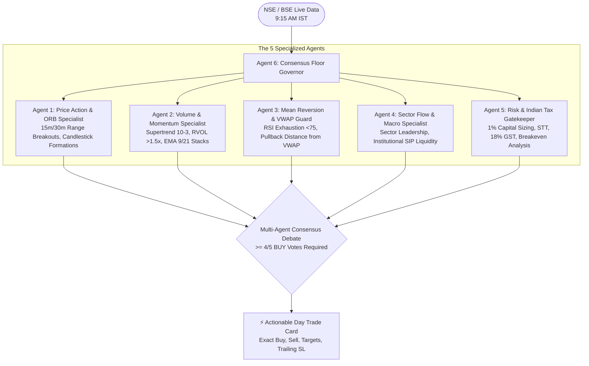

# 🇮🇳 Dalal Street Day Trader

> **Autonomous Multi-Agent Day Trading Desk for the Indian Stock Market (NSE & BSE)**  
> *Scans pre-market & opening momentum, facilitates a 5-agent consensus debate, and gives you exact Buy triggers, Target 1, Target 2, and step-by-step Sell rules.*

[](https://www.python.org/downloads/)
[](https://opensource.org/licenses/MIT)
[](#)
[-blueviolet.svg)](#)
[](#)

---

## 📌 What is This?

**Dalal Street Day Trader** is an intelligent assistant designed to be **kept open on your laptop during market hours (09:00 AM - 03:30 PM IST)**. 

Instead of relying on a single indicator, it convenes a **Council of 5 Specialized AI Agents** that evaluate the market simultaneously from different perspectives, debate each stock, and issue unanimous or supermajority consensus signals.

It tells you:
1. **Which stocks to buy** at the beginning of the trading day.
2. **Exact Buy Trigger price** (enter only when price breaks through the level).
3. **Hard Stop-Loss price** (strict capital defense).
4. **Profit Target 1 (+1.5% to +2.5%)** — when to sell 50% and move Stop-Loss to entry for a risk-free trade.
5. **Profit Target 2 (+3.5% to +5.0%)** — when to sell the remaining 50% shares.
6. **Mandatory 03:15 PM IST square-off rule** to prevent broker auto-squareoff penalties.

---

## 🏛️ Multi-Agent Consensus Council



---

## 🌟 The 5 Agents & Their Roles

| # | Agent Name | Evaluation Lens |
|---|------------|-----------------|
| **1** | **Price Action & ORB Specialist** | Analyzes the 9:15 - 9:45 AM opening 15m/30m candle body, range breakout, and upper shadow rejections. |
| **2** | **Volume & Momentum Specialist** | Verifies Relative Volume (RVOL >= 1.25x), Supertrend bullish support, and EMA 9 > 21 velocity. |
| **3** | **Mean Reversion & VWAP Guard** | Prevents chasing overbought stocks (RSI > 78) and measures safety cushion above Volume Weighted Average Price. |
| **4** | **Sector Flow & Macro Specialist** | Confirms whether the stock's sector (e.g. Nifty Auto, Bank Nifty, Nifty IT) is leading Dalal Street today. |
| **5** | **Risk & Tax Gatekeeper** | Enforces 1% risk budgeting, calculates exact share quantity, audits Indian statutory charges (STT, GST, Stamp duty), and ensures positive post-tax profit expectation. |
| **6** | **Consensus Floor Governor** | Moderates the cross-agent debate, tallies the votes, and issues the final trade card. |

---

## 💻 How to Use on Your Laptop

### 1. Launch the Streamlit Live Dashboard (Recommended)

Keep this running on your laptop screen during market hours:

```bash
streamlit run app.py
```

* Opens in your browser at `http://localhost:8501`.
* Enable the **"Auto-Refresh Live Feed"** checkbox in the sidebar.
* Features real-time NSE market phase clock, live day-trading action cards, and full multi-agent debate transcripts!

### 2. Launch the Terminal HUD Watch Mode

If you prefer keeping a sleek terminal open on your second monitor:

```bash
# Keep open and auto-refresh every 60 seconds
python3 cli.py --watch

# Or run a single morning scan
python3 cli.py
```

---

## 🎯 Step-by-Step Execution Rules

### 1. How & When to Buy
* At **09:15 AM IST**, watch the opening candle.
* Place a **BUY LIMIT / SL-LIMIT** order at the specified **Buy Trigger Price**.
* **Do not buy** if the opening 5-minute candle closes below the hard Stop-Loss.

### 2. How & When to Sell
* **Target 1 Reached:** **SELL 50% OF YOUR SHARES**. Immediately move your stop-loss on the remaining 50% to your entry price. You now have a completely **risk-free runner**.
* **Target 2 Reached:** **SELL THE REMAINING 50% OF YOUR SHARES**. Lock in full day-trading profit.
* **Stop-Loss Hit:** **EXIT 100% OF SHARES IMMEDIATELY** via market order. No averaging down.
* **03:15 PM Cutoff:** **MANDATORY EXIT**. Indian brokers begin auto-squareoff between 3:15 and 3:20 PM. Close any remaining positions before 3:15 PM IST regardless of P&L.

---

## 🧾 Indian Statutory Taxes Accounted For

Every signal's profit expectation is net of actual Indian statutory costs:
* **Securities Transaction Tax (STT):** 0.025% on intraday sell turnover
* **Exchange Turnover Fee:** NSE 0.00297%
* **SEBI Turnover Charge:** ₹10 per crore
* **Stamp Duty:** 0.003% on buy turnover
* **GST (18%):** On brokerage and exchange fees
* **Brokerage:** Discount broker flat model (Zerodha / Groww / Angel One)

---

## 🧪 Running Unit Tests

```bash
python3 -m unittest discover -s tests -p "test_*.py"
```

All 9 unit tests pass in under 0.5s!

---

## 👨‍💻 Author

**Nithillen Jayaseelan**  
GitHub: [@Nithillen](https://github.com/Nithillen)
